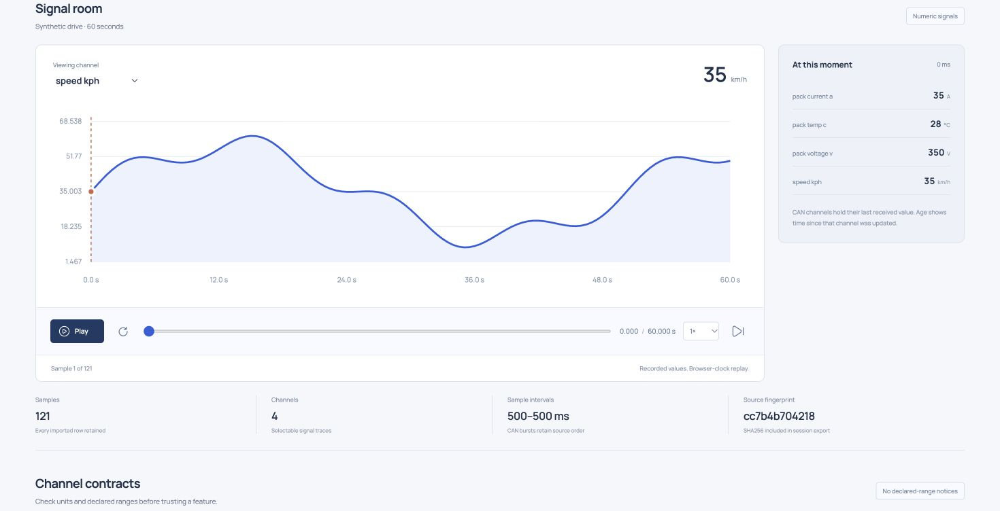

# EdgeReplay

A local telemetry replay and prediction inspection studio. Import a CSV recording,
slow down the timeline, inspect the values at a timestamp, and find disagreements
between labels already recorded by your model pipeline.



## Run

Python 3.10+ is sufficient. No Python runtime packages, account, hardware connection,
API key, or model download is required.

```sh
git clone https://github.com/ryanfer123/EdgeReplay.git
cd EdgeReplay
python3 -m edge_replay
```

Open **http://127.0.0.1:8766**. Choose **Explore sample drive** for a 60-second
synthetic recording or **Try CAN frames** for the included driver feature profile.
Both examples are generated fixtures, not real vehicle measurements.

The app binds to loopback, checks Host headers, and rejects cross-origin writes.
It is a single-user local workbench, with recordings saved in SQLite. It has no
user-account system, remote-device control, or internet deployment configuration.

## What works

- Import up to 20,000 rows, 12 numeric channels, and 3 MiB of CSV.
- Play, pause, restart, change replay speed, scrub by time, or step by sample.
- Select a channel and inspect its waveform with the current value and units.
- Decode the three supported CAN frame IDs into named driver features.
- Inspect carried-forward channel values and their age at each CAN frame.
- Check declared-range notices, minima, maxima, means, and sample intervals.
- Compare optional expected/predicted labels and jump to disagreements.
- Reopen saved recordings and export session JSON or importable CSV.
- Validate and inspect a recording from the terminal.

## Signal CSV format

```csv
time_ms,speed_kph,pack_temp_c,expected_label,predicted_label
0,12.5,28.0,normal,normal
500,16.2,28.1,normal,warning
1000,21.4,28.3,normal,normal
```

`time_ms` is a finite nonnegative timestamp in milliseconds, at most 1e12. Signal
timestamps must strictly increase. Every non-label column must contain a finite
number of magnitude at most 1e100 in every row. Channel identifiers may contain letters, digits, and
underscores and must begin with a letter. Blank values and malformed column
counts are rejected rather than silently filled.

Known channel names carry declared units: `speed_kph`, `pack_temp_c`,
`pack_current_a`, `pack_voltage_v`, `throttle_variation`, `brake_usage_pct`,
`energy_wh_km`, `regen_efficiency`, and `jerk_m_s3`. Other names are treated as
unitless; they are not assigned guessed physical units. Out-of-range values are
retained with notices, capped at 100 entries in the exported summary.

## CAN CSV format

```csv
time_ms,can_id,data_hex
0,0x300,0000704100002041
0,0x301,00000c430000803e
1,0x302,0000003f00000000
```

This is an explicit driver float-pair profile, not a general DBC parser.
Each eight-byte payload is decoded as two little-endian IEEE 754 floats.
Bare IDs such as `300` are interpreted as hexadecimal, as are IDs with `0x` prefixes.

| ID | First float | Second float |
| --- | --- | --- |
| `0x300` | Throttle variation | Brake usage (%) |
| `0x301` | Energy consumption (Wh/km) | Regen efficiency (0..1) |
| `0x302` | Jerk (m/s³) | Padding, ignored after finite-value validation |

CAN timestamps may repeat, retaining source order. Stepping inspects individual
frames even within a same-timestamp burst; time scrubbing and replay select the
last frame at or before the playhead. Channels are absent until first received,
then hold their last received value. Their displayed age is evaluated at the
selected frame timestamp. A populated value does not imply a fresh sensor reading.
Unknown IDs, wrong payload lengths, invalid hex, and non-finite floats are rejected.
CSV export preserves raw CAN frames so it can be imported again.

## Prediction comparisons

Add `expected_label` and `predicted_label` columns to a signal recording. Rows with
both labels are compared exactly after trimming surrounding whitespace. The app
reports pair count, disagreement count, agreement rate, and mismatch timestamps;
the session export also contains a confusion-count table.

These are imported labels. EdgeReplay does **not** run a model, retrain a model,
compile firmware, or establish accuracy against an independently verified dataset.
It does not load pickle files or execute uploaded code. Replay does not transmit
frames to a CAN bus, and browser-clock playback is not a real-time timing guarantee.

## Inspect without a browser

```sh
python3 -m edge_replay --inspect edge_replay/web/demo.csv --output recording.json
python3 -m edge_replay --port 8791 --database experiments.sqlite3
```

Session JSON includes parsed samples, channel statistics, the import contract,
software version, range notices, label audit, and SHA256 of the **original imported
CSV bytes after UTF-8 decoding/re-encoding**. Normalized CSV exports can have a
different checksum because formatting changes. Keep the original CSV when exact
source-byte provenance matters. JSON exports include the imported values and labels;
review those contents before sharing.

The waveform is downsampled for drawing at more than 1,500 points; the inspector,
audit, and exports retain every sample. Downsampling can miss narrow visual spikes.

## Tests and build

```sh
python3 -m unittest discover -s tests -v
python3 -m pip wheel . --no-deps -w dist
```

Tests cover signal statistics, label comparisons, malformed CSV, units, same-time
CAN bursts, float positions, carried values/age, source hashing, raw CAN CSV
round-trips, real HTTP requests, SQLite connection closing, imports/exports and
local access restrictions. CI runs Python 3.10, 3.12 and 3.13.

The frontend has no compilation step. Its locally served Manrope font, Solar icons,
GSAP/ScrollTrigger, and sole Lenis scrolling engine are bundled in the wheel.
Reduced motion skips decorative animation and smooth scrolling. Functional replay
remains available. No WebGL, generated illustration, or external font service is used.

See [applied skills and validation](docs/VALIDATION.md),
[asset provenance](THIRD_PARTY.md), and [contribution guidance](CONTRIBUTING.md).

## License

MIT for application source. Bundled assets retain their own licenses.
